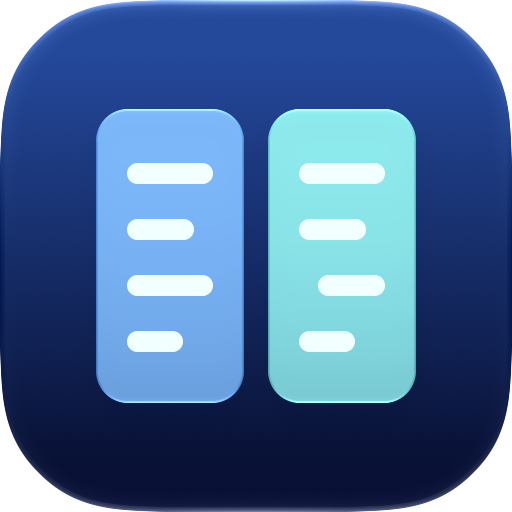

<p align="center">
  
</p>

# SidecarCompare

**Compare MRI JSON sidecars with exact numbers and clear, inspectable differences.**

SidecarCompare is a native macOS utility for reviewing acquisition metadata in
two JSON sidecars. See what changed, inspect original values and documented
units, and copy or export a finding without modifying either input. A Swift
library and optional CLI use the same comparison core.

Use it when reviewing acquisition-parameter changes, checking converter output,
or discussing metadata differences with a collaborator. It compares the supplied
metadata; it does not read images or establish that two scans are scientifically
or clinically comparable.

**[Build and try it](#build-and-run-on-a-mac)** ·
**[Try the CLI](#command-line-comparison)** ·
**[Comparison rules](docs/COMPARISON_RULES.md)** ·
**[Report an issue](https://github.com/jdotc1/SidecarCompare/issues)**

**Status:** version 0.1.0, available as a source/development build. The native app
requires macOS 15+ and Apple Swift 6. Development bundles are ad-hoc signed and
sandboxed; distribution signing, notarization, and install qualification are
separate from the recorded development checks.

## Build and run on a Mac

Install an Apple Swift 6 toolchain with the macOS SDK, then run:

```sh
git clone https://github.com/jdotc1/SidecarCompare.git
cd SidecarCompare
./script/build_and_run.sh
```

The script builds and opens `dist/SidecarCompare.app` with an ad-hoc sandbox
signature. It restarts an existing SidecarCompare process and discards that
process's in-memory session. Input files remain unchanged. The script builds for
the selected host architecture; it does not produce a universal binary.

In the app, choose **Load Synthetic Example** to explore the interface, or choose
or drop one JSON file into **A · Reference** and another into **B · Comparison**.
The checked-in [fixtures](Fixtures/README.md) are also synthetic.

SwiftPM is the canonical project and has no third-party package dependencies or
runtime. Xcode can open [Package.swift](Package.swift). Use the checked-in script
when testing the sandboxed app bundle; the configured Codex Run action uses the
same path.

| Development command | Purpose |
| --- | --- |
| `./script/build.sh debug` | Stage a debug app without opening it. |
| `./script/build.sh release` | Stage an optimized development app. |
| `./script/build_and_run.sh --launch-built` | Open the last staged build. |
| `./script/build_and_run.sh --debug` | Build and launch under LLDB. |
| `./script/build_and_run.sh --logs` | Build, open, and stream system process logs. |
| `./script/build_and_run.sh --verify` | Build, open, and check process existence; this is not GUI acceptance. |

## Read a comparison

The table shows status, escaped **JSON Pointer**, A/B values, and known units.
Select a row to see explicit JSON types, original values, exact **B − A**
differences, and interpretation notes. Unknown fields remain available as raw
JSON.

| Status | Meaning |
| --- | --- |
| Equal | Matching typed values; mathematically equal numbers may have different original spellings. |
| Changed | Unequal values of the same JSON type. |
| Type changed | A value was replaced with another JSON type. |
| A only / B only | A value exists on one side only. |
| Within tolerance | Unequal numbers satisfy your selected rule in an eligible field; they still count as a difference. |

### Exact numbers and units

**Exact** is the default. Numbers compare mathematically without conversion to
`Double`: `1`, `1.0`, and `1e0` are equal, while integers beyond 2^53 remain
distinguishable. Original numeric tokens are retained for inspection and full
reports.

Objects ignore member order; arrays remain positional. Missing, null, strings,
booleans, and container types remain distinct. A missing subtree or container-type
replacement is one row at its root with the full value retained for export.
Counts describe comparison rows, not acquisitions or original header fields.

Documented top-level field names determine unit annotations. The app does not
infer units from magnitude or a generic `Units` field. The seconds/milliseconds
control changes display only; raw values, comparison status, exact signed raw
deltas, and exported units remain unchanged. The [field catalog](Sources/SidecarCore/FieldCatalog.swift)
is deliberately partial and is not a BIDS validator.

Numeric scalar rows show **Absolute delta · |B − A|** in the selected supported
display unit, alongside the existing exact signed raw delta. **Relative change from
A** uses `(B − A) / |A| × 100%`, calculated with decimal integer division and rounded
only for display to six decimal places, ties away from zero. Trailing zeros may be
omitted and extreme results may use scientific notation. A zero reference reports
relative change unavailable. This percentage does not determine tolerance status,
which uses `max(|A|, |B|)`. Reports and comparison classification are unchanged.

**Edit Rule…** opens the numeric rule editor. Optional relative tolerance applies
only to curated MRI quantities with supported numeric shapes; counters, unknown
fields, and nested vendor fields remain exact. For a chosen fraction `r`, the
rule is:

```text
abs(B - A) <= r * max(abs(A), abs(B))
```

There is no absolute tolerance floor. The GUI accepts a percentage; the CLI
accepts a fraction from 0 to 1. Within-tolerance values remain visibly different.
SidecarCompare recommends no scientific tolerance and does not establish scan
equivalence. See the [complete rules and resource limits](docs/COMPARISON_RULES.md).

### Filter, sort, and navigate

Search covers paths and short value previews. Category, Status, and
**Differences only** narrow the table. The **Differences by status** buttons
show counts for the full comparison; clicking one applies its status and enables
Differences only while retaining search/category filters. The view summary shows
active restrictions and visible/total row counts without repeating search text.

Click any column header to sort, then click again to reverse. A/B number sorting
uses exact decimal values; string sorting uses decoded UTF-8 text. Ascending
mixed-type order is missing, null, boolean, number, string, array, object.
Equivalent numeric spellings tie, containers use bounded previews, and stable
row IDs break ties. Descending reverses the order.

**Previous/Next Difference** follows the visible table order and stops at either
end. Use the inspector controls or **Command-Option-Up/Down** from the Comparison
menu. The inspector shows the selected difference's position, such as
“Difference 3 of 9 in this view”; Equal rows are excluded from that count.

**Comparison → Go to JSON Pointer…** selects an exact RFC 6901 row pointer and
opens its inspector. Enter escaped pointers as copied: `/a~1b~0c` refers to a key
containing `/` and `~`. Input is case-sensitive, byte-exact, and not trimmed.
Absent fields disable Go; hidden fields offer **Clear Filters and Go**, preserving
sort, time display, comparison rule, and the inspector Find query.

Inspector **Back / Forward** follows your field-review history independently of
Previous/Next Difference. History is session-only, limited to 100 entries; a new
selection after Back replaces the forward branch. Returning to a field retains view
settings and Find query, restoring saved match/expansion when the query and input
snapshots are unchanged. Hidden targets offer **Clear Filters and Go**; Cancel leaves the
view/history position unchanged. Clear/replacement inputs/example discard history;
successful Reload/Swap/rule changes retain only pointers still present in the full
comparison.

| Recovery action | What changes |
| --- | --- |
| Remove a Status, Category, or Search active chip | Clear just that filter; retain the other presentation settings and any still-visible selection. |
| **Clear Filters** in an empty view | Clear search/category/status and turn off Differences only to reveal all rows. Retain sorting, time display, rule, and snapshots. |
| **Reset View** | Restore ascending JSON Pointer order, Differences only, and seconds display; clear filters, selection, and saved inspector review state. Keep snapshots and the comparison rule. |

Filters, sorting, navigation, and display units never limit exported comparisons.

## Inspect and copy a finding

The inspector separates A/reference and B/comparison into typed value cards.
Type changes show an A → B transition. Long values initially show 512 characters;
**Show more** expands either side to at most 8,192 characters with shown/total
counts, and **Show less** collapses it. Original numeric tokens and JSON escaping
are preserved. Full export and value copying retain complete values.

Previous/Next and side-specific Show more/Show less controls stay in a fixed
header while values scroll. Moving to another field resets expansion and brings
the field heading into view. **Show in Table** scrolls back to the selected field
without changing filters, sort, Find/current match, or A/B expansion.

Resize the inspector by dragging its visible left divider: 270–640 points when
window space permits, with a default of 315. **Reset Inspector Width** restores
that default while preserving the selected field and review state. The table
keeps its minimum width; widening the window provides more room. Width is not
written as an application preference.

### Copy exact values

The inspector's **Copy** menu and each row's context menu provide:

- **Copy JSON Pointer** — the complete escaped pointer.
- **Copy A Value · Original JSON** / **Copy B Value · Original JSON** — the full
  raw JSON, including values beyond preview limits and original numeric tokens.
  A missing side cannot be copied; JSON `null` copies as `null`.

Copied metadata can identify people. Feedback reports success/failure and reminds
you that the system clipboard may be shared across devices.

### Find inside complete values

**Find in values…** searches the selected field's complete A/B raw JSON, including
content beyond the preview. It is literal, case-sensitive, and non-overlapping;
JSON escapes and numeric tokens are searched as serialized. Separate A/B counts
and **Previous Match / Next Match** navigate A first, then B, stopping at either
end. An underlined bounded excerpt shows the current match and its one-based byte
position. Long matches have an explicit excerpt-truncation notice.

**Copy Match Context** copies that bounded excerpt with the side and byte
position, clearly labelled as an excerpt. Use Copy A/B Value for the whole value.
Copy is unavailable when results or matches are unavailable. **Clear Find**
clears only inspector search; it does not change table filters, previews, or
exports.

Hiding and reopening the inspector on the same field and snapshots preserves
Find, the current match, and independent A/B expansion. Ordinary field changes or
reloading snapshots keep the query but restart match navigation and expansion;
Back/Forward can restore saved review when its query and snapshots still match.
Clear, replacement inputs, loading the example, and Reset View clear saved review
state. This state exists only for the current session.

## Refresh or change inputs

Inputs are immutable in-memory snapshots and are not watched automatically.

| Action | Result |
| --- | --- |
| **Reload A / Reload B** | Read that selected file again while the other snapshot remains loaded. A failure clears the failed side's old snapshot and comparison and offers Choose recovery. |
| **Reload Both** | Refresh both selected files before comparing the new pair. A failed side shows its error while a successfully refreshed side stays loaded; no refreshed-versus-stale comparison is presented. |
| **Swap A and B** | Exchange the loaded snapshots and reverse delta direction without rereading files. |
| **Edit Rule…** | Recompute with the selected exact/tolerance rule. |
| **Clear** | Clear the session and reset the comparison rule to exact. |

Reload, Swap, and applying a changed rule preserve filters, sorting, time display,
and the selected field when it remains visible. If selection becomes hidden, the
app explains why it cleared. Swap and rule changes keep the Find query but
recompute matches and collapse previews. Inline reload feedback distinguishes
successful refreshes, failures, cancellation, and comparison errors; clipboard
notices remain separate.

Reload requires live selected sources and is disabled during pending work or
import/export panels. Empty slots and built-in examples cannot reload. Choose
recovery explains how to reopen or replace a missing file while retaining the
other snapshot.

**File → Reveal A in Finder / Reveal B in Finder**, also available from the file
well context menu, reveals the original selected location without rereading it.
If the file moved or access expired, choose it again. Reveal does not search for
moved files or certify that the file now at that path matches the loaded
snapshot. Empty slots and examples have no source to reveal. Closing the single
window discards the session and quits.

## Export and share

Exports default to **summary only**, omitting input keys, values, filenames, and
paths. Full export/copy requires acknowledgment and includes original metadata,
including identifiers or paths already embedded in it. The app does not append
selected-file names or paths. Full export is not de-identification, and neither
mode is a compliance certification.

The export sheet shows **Total rows** and **Currently visible** rows, but always
exports the complete comparison. Summaries count every row; full reports include
every row in canonical sidecar units. Reports record app version, catalog
revision, scope, tolerance, and counts. JSON uses schema version 1 and typed
presence markers. Numeric tokens and deterministic traversal are retained;
source whitespace and object order are not a byte-for-byte snapshot.

The app's atomic writer rejects replacement of loaded source paths and detected
symlink/hardlink aliases. This protects against accidental overwrites, not a
hostile concurrent filesystem actor.

## Command-line comparison

The optional CLI uses the same `SidecarCore` library. Try the synthetic pair:

```sh
swift run sidecar-compare --help
swift run sidecar-compare Fixtures/mri-baseline.json Fixtures/mri-followup.json
```

Default output is a JSON summary. Use `--text` for text output and `--full` to
explicitly include original metadata. For example:

```sh
swift run sidecar-compare --full --relative-tolerance 0.001 \
  Fixtures/mri-baseline.json Fixtures/mri-followup.json
```

The example tolerance is a CLI demonstration, not a recommended MRI tolerance.

| Exit status | Meaning |
| --- | --- |
| `0` | No differences. |
| `1` | Any difference, including a value within tolerance. |
| `2` | An error. |

CLI stdout redirection is performed by your shell and cannot receive the app's
source-write protection. **Never redirect CLI output over an input file.**
Consumers of full JSON reports need decimal handling suitable for the original
numeric range and precision.

## Privacy and scope

There are no app network requests, accounts, telemetry, recent-file database,
or persistent sessions. The development app is sandboxed with user-selected file
access and no network entitlement. The operating system, cloud-backed or
network-mounted folders, backups, screenshots, and clipboard synchronization are
outside that boundary.

The tool does not perform image reading, DICOM conversion, BIDS inheritance or
dataset validation, automatic unit correction, metadata rewriting, registration,
de-identification, clinical interpretation, or radiomics extraction. There are
no model downloads or custom image-viewing framework.

Inputs must be UTF-8 JSON objects. Malformed JSON, duplicate keys, unsupported
roots, and exceeded resource budgets are rejected rather than silently
truncated. The [comparison rules](docs/COMPARISON_RULES.md) define parser limits,
comparison limits, numeric behavior, and the catalog's scope.

## Development and verification

Choose checks relevant to changed inputs; accepted results and their limits are
recorded in [verification](docs/VERIFICATION.md).

```sh
./script/test.sh
./script/test.sh release
python3 script/repository_check.py
python3 script/oracle_check.py
python3 script/oracle_check.py --configuration release
./script/smoke.sh
```

Verification scripts require Python 3.11+ and its standard library. Python is not
bundled with or required by the app or CLI. Existing native receipts cover
comparison, sandboxed import/export, source-write protection, drag/drop,
cancellation, and Light/Dark presentation; the core and CLI also have portable
verification. These records identify actual environments and limitations and do
not imply a new test run for every documentation change. The macOS CI workflow
is manual-only. [Review findings](docs/RED_TEAM_REVIEW.md) record earlier failures
and fixes.

## Repository and contribution

| Path | Contents |
| --- | --- |
| [Sources/SidecarCore](Sources/SidecarCore/) | Parser, exact decimals, field catalog, comparison, reports, source protection, and session state. |
| [Sources/SidecarCompare](Sources/SidecarCompare/) | SwiftUI app and narrow AppKit adapters. |
| [Sources/SidecarCLI](Sources/SidecarCLI/) | Command-line interface. |
| [Tests](Tests/) and [Fixtures](Fixtures/) | Regression tests and synthetic examples. |
| [script](script/) and [Packaging](Packaging/) | Build/verification tools, bundle metadata, and accepted compiled icon resources. |
| [docs](docs/) and [evidence](evidence/) | Design decisions, comparison rules, verification scope, and recorded logs. |

For a bug or improvement, [open an issue](https://github.com/jdotc1/SidecarCompare/issues)
with the app version, comparison rule, expected behavior, and a minimal synthetic
example. Review sidecars and full reports for identifying metadata before sharing.

All supplied fixtures are synthetic. The repository includes no clinical data,
third-party runtime, build cache, signing identity, or compiled application
executable. Licensed under [MIT](LICENSE).

**Copy Field Comparison · Original JSON** in the inspector Copy menu or row context menu copies labeled single-field text: the JSON Pointer encoded as a JSON string, status, current comparison rule, complete original A/B JSON, and exact signed raw numeric delta/canonical unit when available. Missing sides use an explicit `[missing — field absent]` marker; JSON `null` remains `null`. The text contains original metadata, is not de-identified and is independent of table filters/display conversions. Copying preserves inspector review state.

The inspector’s fixed header shows the selected **JSON Pointer and status** above its review controls, so field context remains visible while scrolling long values. Long pointers use at most two lines with middle truncation; the full escaped pointer is available on hover and through Copy JSON Pointer. When selection clears, the header shows **No field selected**. The header does not reset Find, current match, history or A/B expansion.

**Hide Find / Show Find** collapses the inspector search controls and excerpt without clearing the query, completed results or current match. A compact summary shows the current match/side, no matches, searching, unavailable or no query. Reopening restores review progress and leaves selection, history and A/B expansion unchanged. Field changes and reloads retain the collapsed preference; Clear/replacement/example/Reset View restore the initial open Find state alongside their existing query reset. **Clear Find** remains a separate action.

**Search in** selects **Paths & previews** (default), **JSON Pointers only**, or **Value previews only** for table search. Preview searches cover the existing short A/B previews, not complete values; use inspector Find for full-value search. Active search chips and empty-view text identify the chosen scope. Scope changes preserve the other view settings and inspector Find query; hidden selection follows the usual clearing behavior. Clear Filters clears the query but keeps scope, while Reset View restores Paths & previews. Exports remain full-comparison.

**Clear Filters** is also available beside Reset View whenever search, category, status or Differences only is active, including views that still contain matching rows. It reveals all rows while preserving visible selection, sort order, time display, search scope, comparison rule and inspector Find query. It disables when no filters remain; Reset View continues to restore broader presentation defaults.

The table-search prompt follows **Search in**: “Search paths and value previews,” “Search JSON Pointers,” or “Search value previews.” Changing scope preserves the query. Preview-mode help directs you to inspector Find for complete-value searches.

Back/Forward now restores a visited field’s A/B expansion and Find match when the current Find query and input snapshots still match its saved review. It never replaces the current query. Matches are recomputed and the saved index is bounded to the new result count; raw values/search results are not retained per history entry. Changed queries use fresh search/default expansion. Reload, Swap, rule changes and Reset View invalidate saved review settings; replacement inputs/Clear/example discard history as before.

Each inspector A/B card now summarizes its parsed value beneath the JSON type: decoded string character count, immediate array items or object members, **Exact JSON number**, **JSON boolean**, **JSON null**, or **Field absent**. Empty strings explicitly say **Empty string**; empty containers show **0 items / 0 members**. Decoded string counts use Swift characters (extended grapheme clusters), distinct from serialized raw-JSON preview character counts. Summaries do not change review state or original values.

**Pin Field / Unpin Field** in the inspector and row context menu marks fields for session-only review. Pinned rows show a pin beside their JSON Pointer in the table, with a **Pinned field** tooltip. **Pinned only** filters the table to pinned pointers and shows the full pin count; its removable chip clears only that filter. Pin/unpin preserves Find, match and expansion while the field stays visible. Unpinning a selected field under Pinned only clears its now-hidden selection. Clear Filters and pointer/history recovery disable Pinned only without deleting pins; Reset View also retains pins. Reload, Swap and rule changes retain pins still present in the full comparison. Replacement inputs, Clear and loading the example discard pins. **Pin All Visible (count)** adds the currently visible fields to existing pins; its count shows only newly pinnable fields and it disables at zero. **Copy Pinned Pointers (count)** copies all pinned JSON Pointers, including hidden fields, one per line in exact UTF-8 pointer order. It preserves RFC 6901 escaping and shows clipboard success/failure feedback without changing review state. Pin actions share a compact row below the filters. **Clear Pins (count)** removes all pins and turns off Pinned only while preserving other filters, sorting, display settings and inspector review state. It is disabled when there are no pins or while busy. Exports remain independent of pins and table filters.


**Previous Pinned Field / Next Pinned Field** step through visible pins in the current table order, with a pinned-position indicator and no wrapping. Filters, sorting, display settings and inspector Find query are preserved; new-field selection uses normal inspector navigation, while Back/Forward retains saved review state. If all pins are hidden, **Show Pinned Fields** explicitly clears row filters, enables Pinned only and selects the first pin in the retained sort order. Search scope and display settings remain unchanged.


**Go to Pin…** opens a searchable list of all pinned fields, including hidden pins, with comparison status and table visibility. Search matches displayed pointers case-insensitively and stays local to the picker. Select a visible target and choose **Go**, or explicitly choose **Clear Filters and Go** for a hidden target. Sort order, time display, search scope and inspector Find query are preserved. Cancel leaves the current review unchanged.
